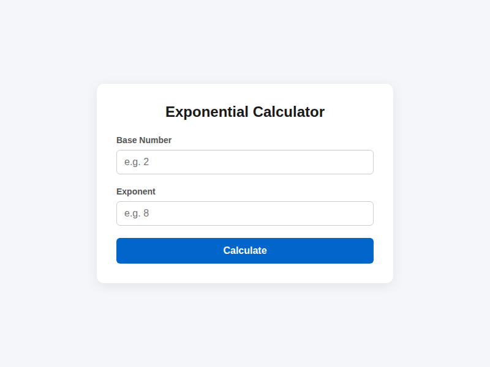
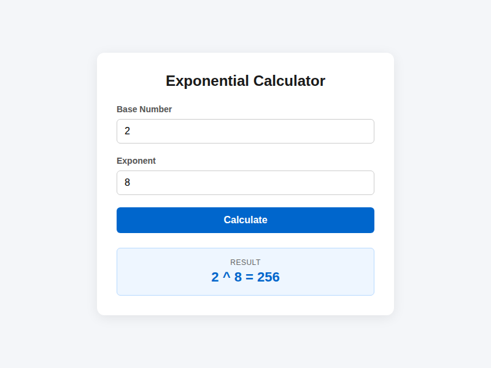

# built-by-magic

A Node.js starter project configured for automated AI development, providing mathematical utility functions and an automated testing suite.

## Features

- Exponential calculation utility function (`calculatePower`)
- Input validation utilities
- Web-based calculator interface (`public/index.html`)
- Unit tests using Jest
- Continuous Integration workflow via GitHub Actions

## Frontend Screenshots

Here is the application front end in action:

### Initial View


### Calculation Result


## Requirements

- Node.js (v18 or higher recommended)
- npm

## Getting Started

1. **Clone the repository:**
   ```bash
   git clone <repository-url>
   cd built-by-magic
   ```

2. **Install dependencies:**
   ```bash
   npm install
   ```

## Usage

You can import and use `calculatePower` from `src/index.js`:

```javascript
const { calculatePower } = require('./src/index');

// Example usage:
console.log(calculatePower(2, 3)); // Outputs: 8
console.log(calculatePower(5, 0)); // Outputs: 1
console.log(calculatePower(4, 0.5)); // Outputs: 2
```

## Available Scripts

- `npm test`: Runs the Jest test suite.

## Testing

Unit tests are located in the `tests/` directory and use [Jest](https://jestjs.io/).

To execute the tests:

```bash
npm test
```

The tests verify:
- Standard exponential operations (positive, negative, fractional exponents)
- Edge cases (exponent of zero, zero base)
- Input validation throwing appropriate `TypeError` for invalid inputs (strings, `null`, `undefined`, `NaN`, `Infinity`)

## CI/CD Workflow

GitHub Actions runs automated test checks on every `push` and `pull_request` targeting the `main` branch. The workflow installs dependencies and runs `npm test` across Node.js versions 18, 20, and 22.
